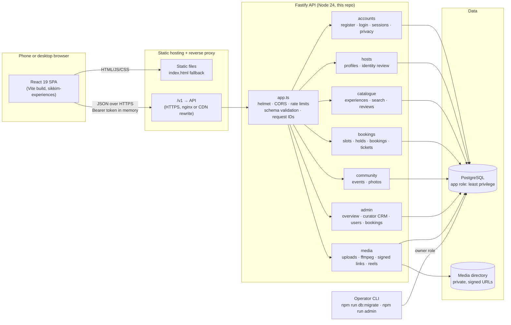
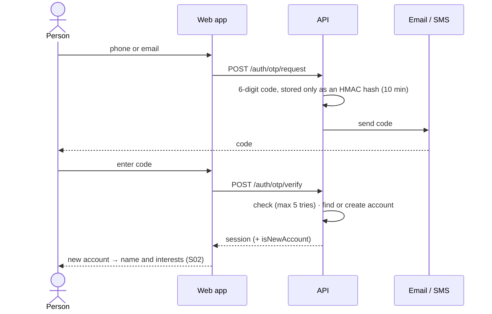
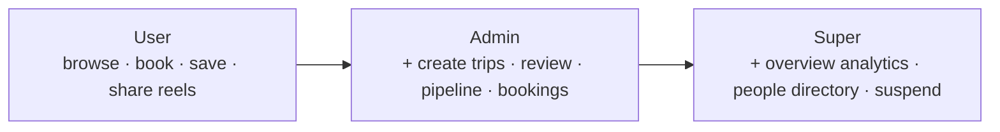
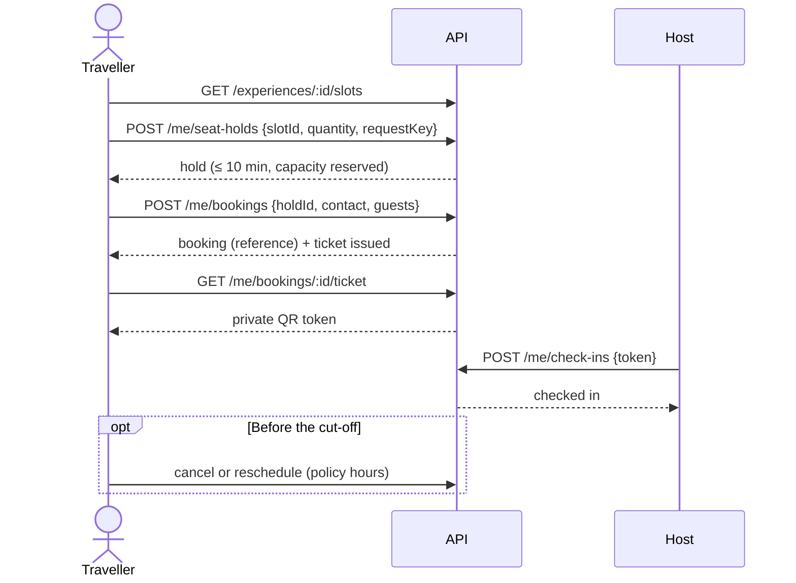
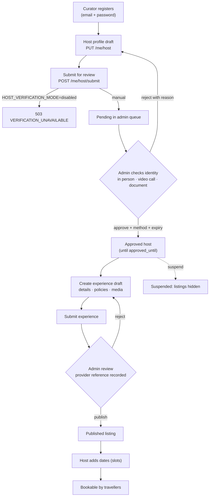
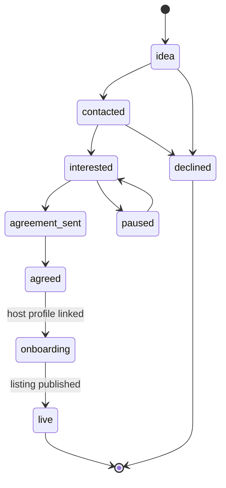
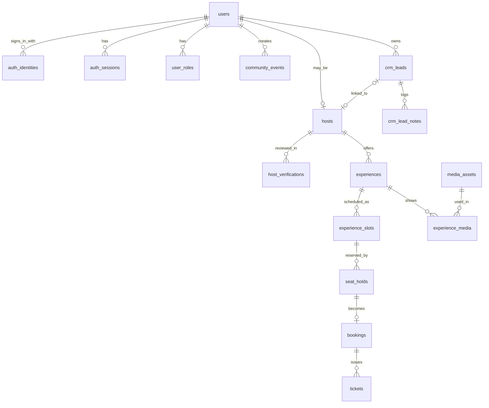

# Architecture and workflows

Sikkim Experiences is two deployables: a React single-page app and a Fastify API backed by PostgreSQL. Diagrams use Mermaid, which GitHub renders.

## System architecture



Design rules that shape the code:

- **Configuration comes only from the environment.** Hosts, origins, database URLs, keys and feature modes are read in `src/config.ts` and validated at startup; nothing is hardcoded.
- **Two database roles.** `sikkim_owner` runs migrations and operator commands. The API connects as `sikkim_app`, which cannot create tables, change roles, rewrite consent history or edit the audit log.
- **Every write runs in one transaction** (`Database.transaction`) and records an `audit_logs` row.
- **Optimistic concurrency.** Editable records carry a `revision`; stale writes get `409` and the client reloads.
- **Errors never leak internals.** Responses are `{error: {code, message, requestId}}`; logs redact tokens and cookies.

## Sign-in with a one-time code



## Account types



Roles are granted only with `npm run admin` on the server.

## Request lifecycle

```mermaid
sequenceDiagram
  participant B as Browser (ApiClient)
  participant F as Fastify
  participant S as Service
  participant P as PostgreSQL
  B->>F: GET/POST /v1/... (Authorization: Bearer)
  F->>F: rate limit · JSON schema · CORS
  F->>S: handler(token, input, requestId)
  S->>P: BEGIN
  S->>P: lock account + session (accountAccess)
  S->>P: role check (admin endpoints)
  S->>P: queries / writes + audit row
  S->>P: COMMIT
  S-->>F: data
  F-->>B: 200 {data, page?} or {error}
  Note over B: Token refreshes before expiry;<br/>sessions last 30 min, max 24 h
```

## Booking workflow (free bookings)



Paid bookings are blocked (`PAYMENT_UNAVAILABLE`) until a payment gateway is added.

## Host onboarding, verification and publishing



## Curator CRM pipeline

Leads live in `crm_leads`; every stage change and every call, visit or message is appended to `crm_lead_notes`.



Readiness checks tracked per lead: contact confirmed, agreement signed, photos or videos received, media rights note received, write-up final, site visit, verdict. The Overview tab turns these into the pilot tracker table per district.

## Admin workspace

| Tab       | Purpose                                                         | API                                                  |
| --------- | --------------------------------------------------------------- | ---------------------------------------------------- |
| Overview  | Live metrics, bookings by area, pipeline funnel, pilot tracker  | `GET /admin/overview`                                |
| Pipeline  | Curator CRM: search, filter, follow-ups, lead detail and notes  | `/admin/leads`, `/admin/leads/:id`, `.../notes`      |
| Approvals | Pending hosts, experiences and media, linking to review screens | `/admin/hosts`, `/admin/experiences`, `/admin/media` |
| Hosts     | Hosts by status, approval expiry                                | `GET /admin/hosts?status=`                           |
| Users     | Search people, roles (read-only), suspend or restore            | `/admin/users`, `/admin/users/:id/status`            |
| Bookings  | Look up by reference, guest, email or experience                | `GET /admin/bookings`                                |

Admin access itself is granted only with the operator command (`npm run admin -- grant --email=…`), so the API can never escalate privileges.

## Data model (main tables)


