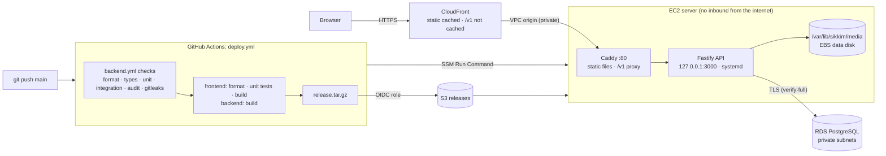

# AWS deployment

Every push to `main` deploys automatically. GitHub Actions runs the checks, builds both apps and installs the release on one AWS server. Users reach it over HTTPS through CloudFront.

| Piece                 | AWS service                                  | Notes                                                                                                                                               |
| --------------------- | -------------------------------------------- | --------------------------------------------------------------------------------------------------------------------------------------------------- |
| HTTPS address and CDN | CloudFront (`https://<id>.cloudfront.net`)   | Caches the app's static files at edge locations, including India. `/v1/*` is never cached.                                                          |
| Web server and API    | EC2 `t4g.small`, Ubuntu 24.04 arm64          | Caddy serves `frontend/dist` and proxies `/v1` to the API on `127.0.0.1:3000`. No public ports: only CloudFront reaches it, privately (VPC origin). |
| Uploaded media        | Separate 10 GB EBS disk at `/var/lib/sikkim` | Snapshot daily, 7 kept. The disk survives server replacement.                                                                                       |
| Database              | RDS PostgreSQL 17, `db.t4g.micro`            | Private subnets, encrypted, verified TLS. Point-in-time backups: 1 day on the Free plan (`DbBackupDays`; raise to 7 after upgrading).               |
| Releases              | S3 bucket (private)                          | One `.tar.gz` per commit, deleted after 30 days.                                                                                                    |
| Deploy access         | IAM role for GitHub OIDC                     | Only this repo's `production` environment (branch `main`) can assume it. No AWS keys are stored in GitHub.                                          |

Region: `ap-southeast-2` (Sydney). This account's organisation policy allows no other region.



## What a deploy does

1. **Backend checks** (`backend.yml`): format, types, unit tests, integration tests against PostgreSQL, `npm audit` and a secret scan.
2. **Frontend checks and build**: `format:check`, unit tests and `npm run build` with `VITE_DATA_MODE=api` and `VITE_API_BASE_URL=/v1`. The Playwright suites run in `frontend.yml`; they do not block a deploy.
3. **Package** `frontend/dist`, `backend/dist`, the migrations, the lockfile and `deploy/aws/server/` into one tarball, then upload it to S3.
4. **On the server** (SSM Run Command, as root):
   - [`server/install.sh`](server/install.sh) installs anything missing: Caddy, ffmpeg, the PostgreSQL client and Node 24, pinned and checksum-checked in [`server/versions.env`](server/versions.env). It mounts the data disk, creates the server's secrets once, prepares the database roles on first run, writes `/etc/sikkim/api.env` and updates Caddy.
   - [`server/release.sh`](server/release.sh) runs `npm ci --omit=dev`, then the migrations as `sikkim_owner`. It switches `/opt/sikkim/current`, restarts `sikkim-api` and waits for `/v1/health/ready`. **If the API does not become ready, the previous release is restored and the deploy fails.**
5. **CloudFront invalidation**, then a smoke test of `/v1/health/ready` and `/` through the public URL.

Deploys run one at a time. To redeploy without a new commit, use **Actions → Deploy → Run workflow**.

## Configuration and secrets

Nothing about this environment is written in the code.

- **CloudFormation** ([`stack.yaml`](stack.yaml)) writes non-secret settings to the SSM parameter `/sikkim-prod/config`: the public origin, the database host and the data disk ID.
- **The server** generates its own secrets on first deploy: database role passwords, `MEDIA_SIGNING_KEY` and `OTP_SECRET`. They live in `/var/lib/sikkim/secrets/secrets.env` on the data disk and never leave the server. The RDS admin password lives in Secrets Manager, managed by RDS.
- **`/etc/sikkim/api.env`** is rebuilt on every deploy. To add settings such as the AI brief, put them in `/etc/sikkim/overrides.env` (root, mode 600) and redeploy:
  ```sh
  AI_PROVIDER=anthropic
  AI_MODEL=claude-opus-5-5
  ANTHROPIC_API_KEY=...
  ```
- **GitHub** keeps only the deploy target names (role ARN, bucket, instance ID and so on), as variables of the `production` environment.

Production uses `NODE_ENV=production`, `MEDIA_STORAGE_MODE=single_server`, `TRUST_PROXY_CIDRS=127.0.0.1/32`, `OTP_DELIVERY=disabled` and `HOST_VERIFICATION_MODE=manual`.

Caddy trusts `X-Forwarded-For` only from CloudFront's origin-facing addresses. It passes the viewer's IP to the API, so per-IP rate limits work.

## First-time setup (already done for `sikkim-prod`)

```sh
aws login                      # an account allowed to create IAM, EC2, RDS, CloudFront
gh auth login
deploy/aws/setup.sh            # 15-25 minutes the first time
```

`setup.sh` deploys the stack and creates the GitHub `production` environment, limited to `main`. It then stores the stack outputs as that environment's variables. Re-run it after changing `stack.yaml`. It pins the Ubuntu image on first deploy, because a new image would replace the server.

## Operating the server

There is no SSH. Open a shell with Session Manager (needs the AWS CLI Session Manager plugin):

```sh
aws ssm start-session --region ap-southeast-2 --target <INSTANCE_ID>
```

```sh
sudo systemctl status sikkim-api caddy
sudo journalctl -u sikkim-api -n 100 --no-pager
curl -fsS http://127.0.0.1:3000/v1/health/ready
readlink /opt/sikkim/current                      # live release (commit SHA)

sudo sikkim-admin list                            # staff accounts
sudo sikkim-admin grant --email=you@example.com --role=super
printf '%s' "$PASSWORD" | sudo sikkim-admin set-password --email=you@example.com
```

**Roll back:** run **Deploy** for an older commit (Actions → Deploy → Run workflow, then choose the commit), or revert on `main`. Database migrations are not rolled back. Restore the database to a point in time from the RDS console if needed.

## Cost (Sydney, before the free plan's credits)

About **USD 40 a month**: EC2 `t4g.small` ~15, RDS `db.t4g.micro` + 20 GB ~20, EBS ~3, public IPv4 ~4, plus Secrets Manager and snapshots under 1. CloudFront and S3 stay within the always-free allowance at pilot traffic.

The account is on the AWS **Free plan**: USD 100 credit, ending 2027-05-21. When the credit or the plan ends, upgrade the account to a paid plan, or AWS closes it.

## Known limits

- **No one can sign in yet.** Accounts are created by a first sign-in with a one-time code. Production refuses `OTP_DELIVERY=console`, and no email or SMS provider is connected, so codes cannot be sent. `sikkim-admin set-password` needs an existing account. Browsing works without signing in. The fix is an email (Amazon SES) or SMS provider, or an admin command that creates a staff account.
- **CloudFront address only.** To use a domain, add an ACM certificate (in `us-east-1`) and an alias to the distribution. Then set the new origin. Today `publicOrigin` in `stack.yaml` comes from the CloudFront domain.
- **One server.** No load balancing and no zero-downtime restarts: each deploy has a few seconds of `502` while the API restarts. The setup is built for the pilot, as in the backend's `single_server` media mode.
- **The server is in Sydney** while users are in India: API calls take about 150 ms longer than from Mumbai. Static files come from CloudFront edges in India.
