# Architecture and workflows

Sikkim Experiences is one repository with two deployables: a React single-page app (`frontend/`) and a Fastify API backed by PostgreSQL (`backend/`). Diagrams use Mermaid, which GitHub renders.

## System architecture

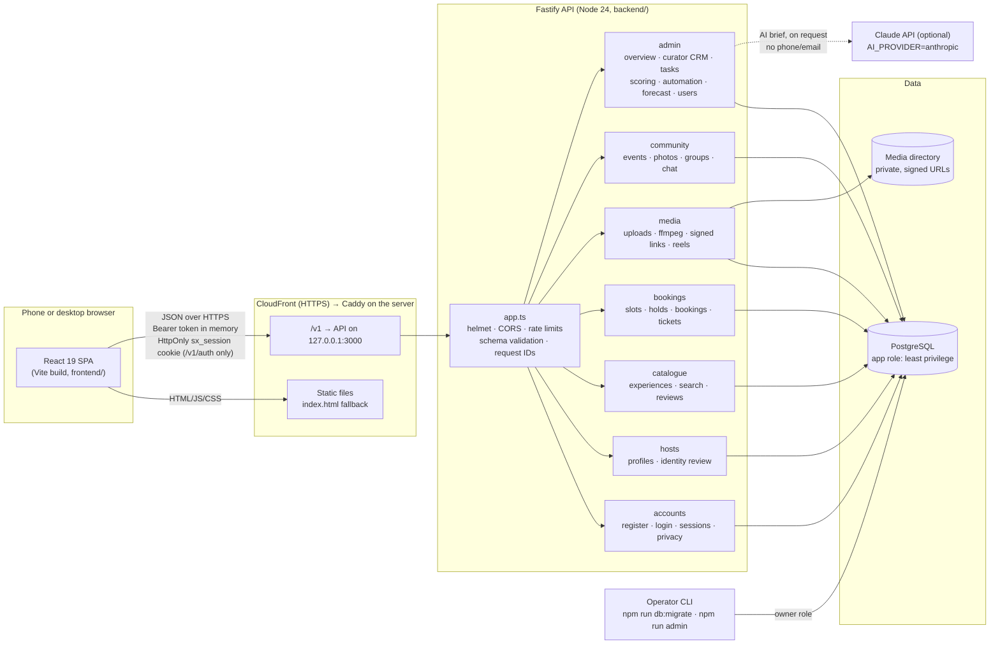

In production all of this runs on one AWS server behind CloudFront, with RDS for PostgreSQL. Every push to `main` is deployed. See [AWS deployment](../deploy/aws/README.md) for the deployment diagram and pipeline.

Design rules that shape the code:

- **Configuration comes only from the environment.** Hosts, origins, database URLs, keys and feature modes are read in `src/config.ts` and validated at startup; nothing is hardcoded.
- **Two database roles.** `sikkim_owner` runs migrations and operator commands. The API connects as `sikkim_app`, which cannot create tables, change roles, rewrite consent history or edit the audit log.
- **Every write runs in one transaction** (`Database.transaction`) and records an `audit_logs` row.
- **Optimistic concurrency.** Editable records carry a `revision`; stale writes get `409` and the client reloads.
- **Errors never leak internals.** Responses are `{error: {code, message, requestId}}`; logs redact tokens and cookies.

## Sign-in with a one-time code

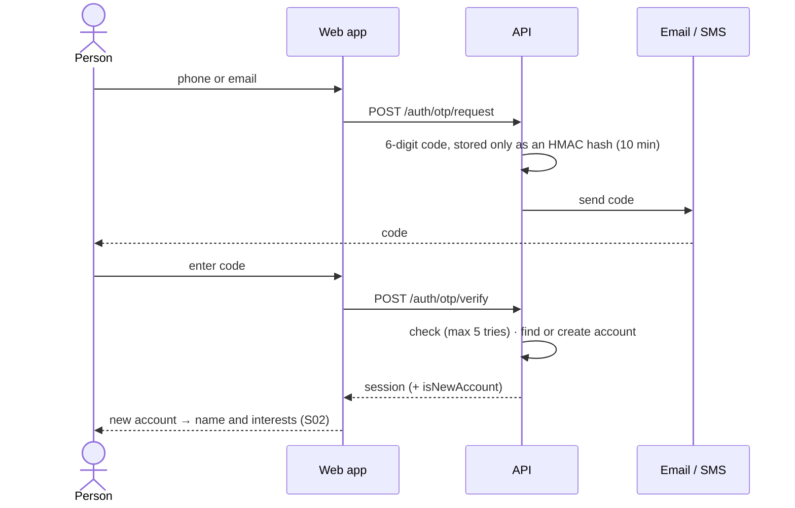

### Or with a password

Every account can also add a password (Profile → Password & sign-in), then sign in with its mobile number **or** email and that password. The one-time code keeps working.

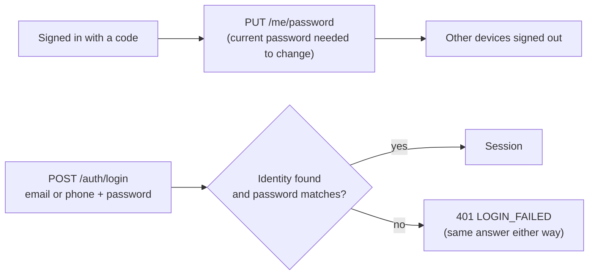

## Account types

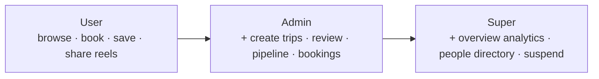

Roles are granted only with `npm run admin` on the server.

## Request lifecycle

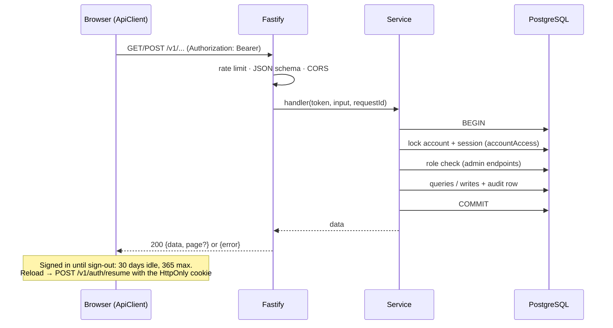

## Booking workflow (free bookings)

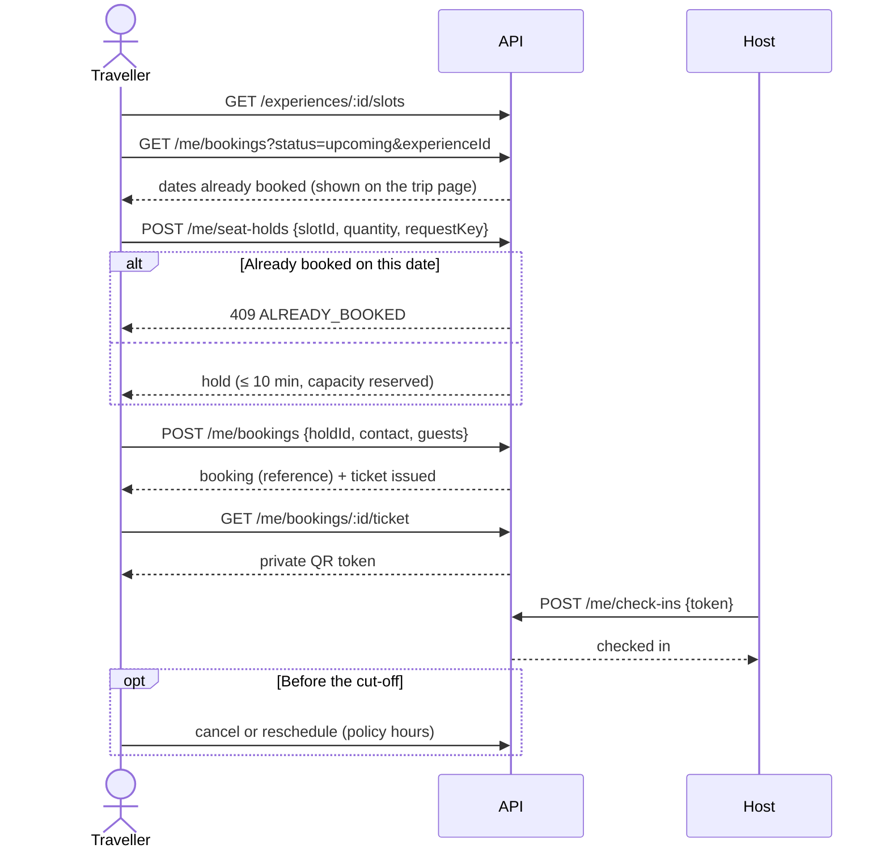

Paid bookings are blocked (`PAYMENT_UNAVAILABLE`) until a payment gateway is added. A traveller gets one confirmed booking per date (`ALREADY_BOOKED`), checked under the same per-experience lock as capacity, so two tabs cannot both book the same date.

## Community groups and chat

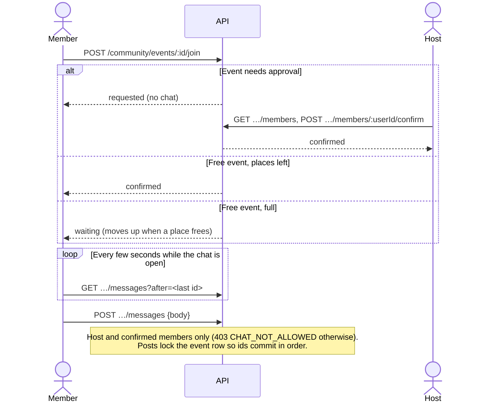

## Host onboarding, verification and publishing

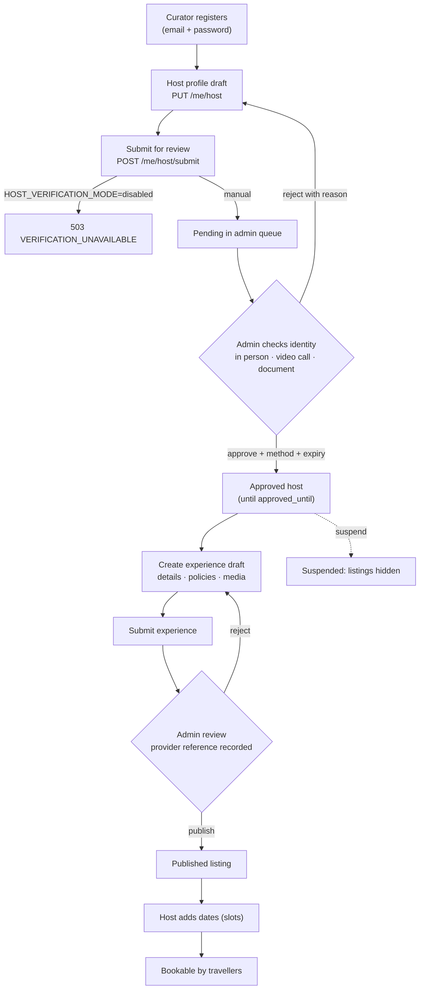

## Curator CRM pipeline

Leads live in `crm_leads`; every stage change and every call, visit or message is appended to `crm_lead_notes`.

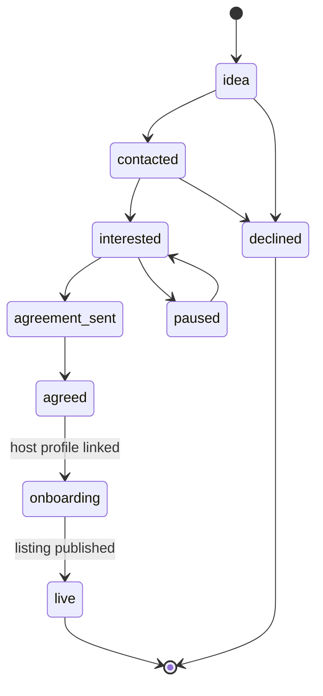

Readiness checks tracked per lead: contact confirmed, agreement signed, photos or videos received, media rights note received, write-up final, site visit, verdict. The Overview tab turns these into the pilot tracker table per district.

### Lead score, automation and the AI brief

Every write to a lead runs these steps in one transaction (`admin/service.ts` → `admin/automation.ts`), so a lead and its automatic tasks are always saved together. The model call for an AI brief runs **outside** any transaction, between two short ones, so a slow model never holds a database lock.

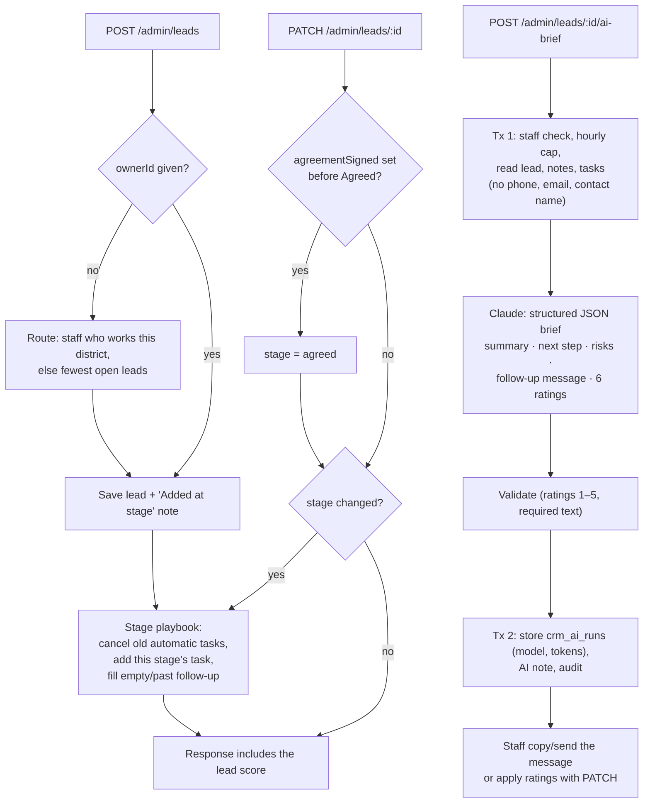

**Lead score (0–100):** assessment average across the six criteria (35) + stage (25) + readiness checklist (20) + activity in the last 7/14/30 days (15, minus 5 if the follow-up is overdue) + verdict (5). Hot is 70+, warm 40+. Calls, visits, messages, notes, stage moves and finished tasks count as activity; automatic and AI entries do not.

**Revenue forecast (`GET /admin/crm/report`):** booking value = seats × slot price (pilot bookings are free and paid to hosts in cash). Run rate = average of the last three full months. Weighted pipeline = each open lead's `expected_monthly_paise` × its stage probability (5% idea … 90% onboarding). Projection per month = max(already booked, run rate) + weighted pipeline from next month on.

## Admin workspace

| Tab                  | Purpose                                                                                  | API                                                                          |
| -------------------- | ---------------------------------------------------------------------------------------- | ---------------------------------------------------------------------------- |
| Overview             | Live metrics, bookings by area, pipeline funnel, pilot tracker                           | `GET /admin/overview`                                                        |
| Pipeline             | Curator CRM: search, filter, follow-ups, lead score, lead detail, notes, tasks, AI brief | `/admin/leads`, `/admin/leads/:id`, `.../notes`, `.../tasks`, `.../ai-brief` |
| Tasks                | My or everyone's follow-up tasks; calendar (.ics) download                               | `/admin/tasks`, `/admin/tasks/:id`, `/admin/crm/tasks.ics`                   |
| CRM insights (super) | Revenue forecast, pipeline health, team performance, CSV export                          | `/admin/crm/report`, `/admin/crm/leads.csv`                                  |
| Approvals            | Pending hosts, experiences and media, linking to review screens                          | `/admin/hosts`, `/admin/experiences`, `/admin/media`                         |
| Hosts                | Hosts by status, approval expiry                                                         | `GET /admin/hosts?status=`                                                   |
| Users                | Search people, roles (read-only), suspend or restore                                     | `/admin/users`, `/admin/users/:id/status`                                    |
| Bookings             | Look up by reference, guest, email or experience                                         | `GET /admin/bookings`                                                        |

Admin access itself is granted only with the operator command (`npm run admin -- grant --email=…`), so the API can never escalate privileges.

## Data model (main tables)

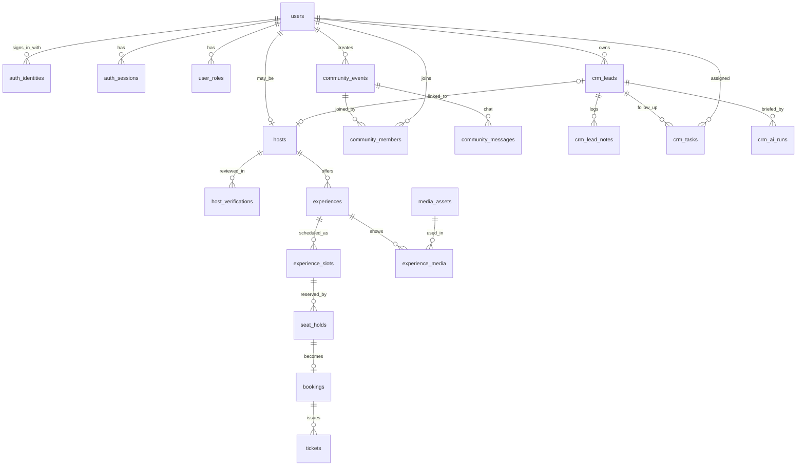
