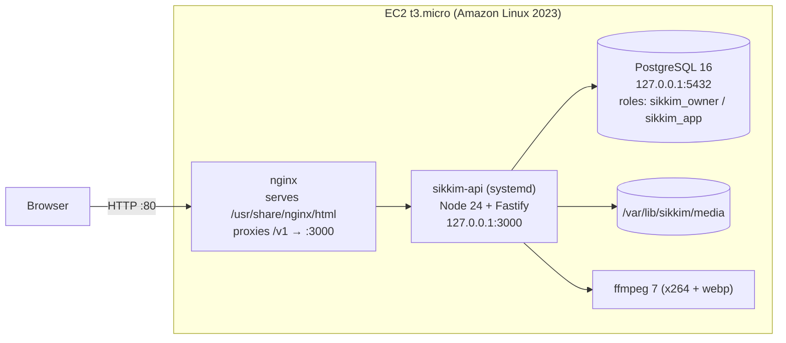

# AWS test deployment (free-tier)

A single-instance **testing** deployment on AWS free-tier. Not production-hardened
(see the checklist at the end before real users). Everything is configured through
environment files on the server; nothing secret is committed to this repo.

## What is deployed

| Thing | Value |
| ----- | ----- |
| AWS account | `106490371278` |
| Region | `ap-southeast-2` (Sydney) |
| EC2 instance | `i-066df37b0f7b82e4f` — `t3.micro`, Amazon Linux 2023, 20 GB gp3 |
| Public URL | http://16.179.252.3/ |
| Public DNS | `ec2-16-179-252-3.ap-southeast-2.compute.amazonaws.com` |
| Security group | `sg-0e8387c4ccb74cf67` — SSH from the operator IP only; 80/443 public |
| SSH key (local) | `~/.ssh/sikkim-ec2.pem` (chmod 600) |
| Cost guardrail | AWS Budget `sikkim-free-tier-guard` — email alerts at $1 and $5 |

All of frontend, backend, database, media and the reverse proxy run on the **one**
`t3.micro`. No load balancer, NAT gateway, RDS or CloudFront — these are the
services that cost money, and they are deliberately avoided for the test phase.

## Topology



## Software installed on the box
- Node **v24.22.3** (`/usr/local/bin/node`, from nodejs.org tarball)
- PostgreSQL **16** (`dnf`), initialised at `/var/lib/pgsql/data`, scram auth on loopback
- ffmpeg **7** static build with libx264 + WebP (`/usr/local/bin/ffmpeg`)
- nginx **1.30** (`dnf`)
- 2 GB swap (so builds don't OOM on 1 GB RAM)

## Where config and secrets live (never in this repo)
- Backend env: `/home/ec2-user/sikkim/backend/.env` (chmod 600) — DB URLs, `OTP_SECRET`,
  `MEDIA_SIGNING_KEY`, all generated with `openssl rand` on the server.
- Postgres superuser password: `/home/ec2-user/.pg_super` (chmod 600).
- This test config runs `NODE_ENV=development`: `OTP_DELIVERY=console` (codes appear in
  the server log), `AI_PROVIDER=disabled`, media in `local` mode, and
  `ENABLE_DEMO_AUTH=true` so the preview catalogue can be loaded.
- **Sample catalogue content** comes from `npm run db:preview` (12 preview experiences,
  4 hosts). This is distinct from `npm run db:seed` (base data only). `db:preview`
  requires `NODE_ENV=development` + `ENABLE_DEMO_AUTH=true` + the `sikkim-local-only`
  database marker. Without it the catalogue is empty and the home feed looks blank.
- **Preview media** is a separate step and needs ffmpeg:
  `npm run db:media-preview -- --from=/home/ec2-user/sikkim/frontend/public/videos`
  It processes the 3 credited Creative-Commons reels into `media_assets` (served as
  signed `/v1/media/...` URLs). Only 3 of the 12 preview experiences have media by
  design; the rest intentionally show the "A little wonder awaits" placeholder. Run
  `db:preview` first, then `db:media-preview`.
- **Concept images on the other preview cards:** the box's `frontend/.env` sets
  `VITE_PREVIEW_IMAGES=true`, so `preview-` experiences without media show the
  category concept image (food → momos, culture → monastery, wellness → forest, else
  Himalayan dawn). These are AI placeholders with unconfirmed rights: **remove the flag
  for production**. Real host-created experiences without an uploaded photo still show
  the placeholder until the host adds one.

## Signup / sign-in codes by email (Amazon SES)

The app gained an `email` OTP delivery mode (`backend/src/accounts/ses.ts`, gated by
`OTP_DELIVERY=email`). Codes are sent via Amazon SES. Config:
- `.env`: `OTP_DELIVERY=email`, `SES_FROM_ADDRESS=<verified sender>`, `AWS_REGION=ap-southeast-2`
- Credentials: the EC2 **instance profile** `sikkim-ec2-profile` (role `sikkim-ec2-role`,
  `ses:SendEmail`) — **no keys in env**.
- Sender verified with `aws ses verify-email-identity` (recipient must click the link).

**SES is in sandbox:** it only delivers to **verified** addresses (200/day). To let any
member of the public sign up, request SES production access, and — because a gmail.com
sender fails DMARC — verify a real **domain** in SES with DKIM for reliable inbox delivery.
Until then, email signup only works to addresses you have verified.

## Operations

```sh
# SSH in
ssh -i ~/.ssh/sikkim-ec2.pem ec2-user@16.179.252.3

# Service control (backend)
sudo systemctl {status|restart|stop|start} sikkim-api
sudo journalctl -u sikkim-api -f           # logs (OTP dev codes show here)

# nginx
sudo systemctl restart nginx
```

### Redeploy after code changes (from a dev machine)
```sh
# 1) sync source (excludes node_modules/.git/.env)
rsync -az --delete \
  --exclude node_modules --exclude dist --exclude .git \
  --exclude '.env' --exclude '.env.*' \
  -e "ssh -i ~/.ssh/sikkim-ec2.pem" \
  ./ ec2-user@16.179.252.3:/home/ec2-user/sikkim/

# 2) on the box: rebuild + migrate + publish + restart
ssh -i ~/.ssh/sikkim-ec2.pem ec2-user@16.179.252.3 '
  export PATH=/usr/local/bin:$PATH
  cd ~/sikkim/backend && npm ci && npm run build && npm run db:migrate && sudo systemctl restart sikkim-api
  cd ~/sikkim/frontend && npm ci && npm run build && sudo rm -rf /usr/share/nginx/html/* && sudo cp -r dist/. /usr/share/nginx/html/
'
```

### Mirror local data onto the box (data-only, version-safe)
Local dev is PostgreSQL 17, the box is 16, so a full dump won't restore (downgrade).
Use a **data-only** copy — schemas match because both ran the same migrations:
```sh
# on dev machine: dump data only, strip pg17-only GUCs
pg_dump "$MIGRATION_DATABASE_URL" --data-only --disable-triggers --no-owner -Fp \
  | sed -E '/^SET transaction_timeout/d' > data.sql
scp -i ~/.ssh/sikkim-ec2.pem data.sql ec2-user@16.179.252.3:~/
rsync -az -e "ssh -i ~/.ssh/sikkim-ec2.pem" backend/.local-media/ \
  ec2-user@16.179.252.3:/var/lib/sikkim/media/            # media files
# on the box (as postgres superuser):
sudo systemctl stop sikkim-api
#   TRUNCATE every public table RESTART IDENTITY CASCADE, then:
psql -h 127.0.0.1 -U postgres -d sikkim_dev -f ~/data.sql
sudo systemctl start sikkim-api
```
Local accounts (and their passwords) come across. Reset one if needed:
`npm run admin -- set-password --email=super@local.test`.

### Grant staff access / passwords
```sh
cd ~/sikkim/backend
npm run admin -- grant --email=someone@example.com --role=super
printf '%s' "$PW" | npm run admin -- set-password --email=someone@example.com
npm run admin -- list
```

## Cost control (staying free)
- Budget `sikkim-free-tier-guard` emails you at $1 and $5 (actual + forecast).
- You are on AWS's **new free plan**: resources stop at the free limit; your card is
  **not** charged unless you explicitly upgrade to a paid plan.
- **Owner pause switch (legitimate):** because this is *your* AWS account and instance,
  you can stop the box anytime to pause the app (and compute billing):
  ```sh
  aws ec2 stop-instances  --instance-ids i-066df37b0f7b82e4f   # app offline, keeps disk
  aws ec2 start-instances --instance-ids i-066df37b0f7b82e4f   # back online (new public IP)
  ```
  Note: a stopped-then-started instance gets a **new public IP** unless an Elastic IP is
  attached. Stopped instance = no compute charge; the 20 GB EBS disk is still within free
  limits.

## Before production (hardening checklist)
These are required by `src/config.ts` when `NODE_ENV=production`, and are **not** done yet:
- [ ] Domain name pointed at the server (needed for HTTPS and `PUBLIC_API_ORIGIN`)
- [ ] TLS cert (Let's Encrypt / certbot) → serve over HTTPS, `FRONTEND_ORIGINS` https
- [ ] `DB_TLS=true` with a cert on the local PostgreSQL loopback
- [~] Email OTP via SES is wired up (sandbox). For production: request SES production
      access + verify a domain with DKIM. SMS codes still need a provider (SNS/Twilio).
- [ ] `MEDIA_STORAGE_MODE=single_server` + `TRUST_PROXY_CIDRS=127.0.0.1/32`
- [ ] HTTPS first: the sign-in cookie (`sx_session`) becomes `Secure` in production, so
      "stay signed in after reload" only works over HTTPS there. On this plain-HTTP test box
      (`NODE_ENV=development`) it is not `Secure` and works as is.
- [ ] Database backups (e.g. nightly `pg_dump` to S3) + instance snapshots
- [ ] Elastic IP so the address is stable across restarts
- [ ] Optional: move frontend to S3 + CloudFront and DB to RDS when you buy plans
```
