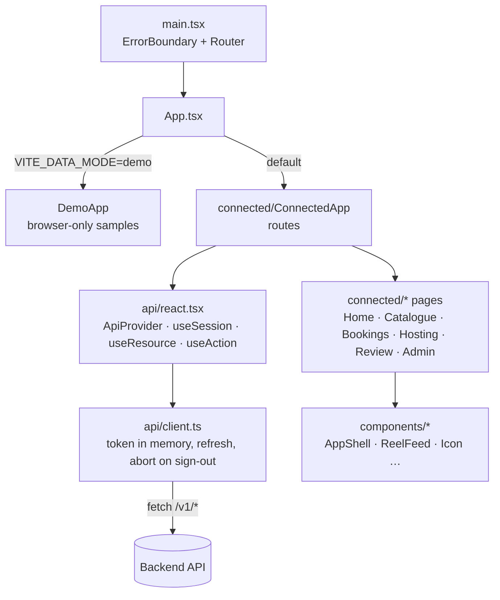

# Sikkim Experiences

React 19 · TypeScript · Vite · React Router. A mobile-first web app for discovering and booking local experiences in Sikkim, plus host and admin workspaces. It talks to the [backend API](../backend) under `/v1`.

- [System architecture and workflow diagrams](../docs/ARCHITECTURE.md)
- [Design rules and media credits](docs/DEMO.md) · [Approved prototype](docs/design-references/)
- [Remaining work](docs/planning/BACKLOG.md)

## Screens

| Area                         | Routes                                                                                                                         | Data                            |
| ---------------------------- | ------------------------------------------------------------------------------------------------------------------------------ | ------------------------------- |
| Discovery                    | `/`, `/explore` (reels), `/explore?view=list`, `/experiences/:slug`, `/hosts`                                                  | API                             |
| Booking                      | `/experiences/:slug/book`, `/essentials/bookings`, tickets                                                                     | API (free bookings)             |
| Account                      | `/welcome` (one-time code by phone or email), `/onboarding` (name + interests), `/account`, `/settings`, `/saved`              | API                             |
| Community                    | `/community`, events, stories                                                                                                  | API (chat is still sample data) |
| Travel Essentials            | `/essentials`, `/essentials/:section`                                                                                          | Built-in guidance               |
| Host workspace               | `/hosting`, listings, dates, media, stories                                                                                    | API                             |
| Review                       | `/review`, `/review/hosts/:id`, `/review/experiences/:id`, `/review/media`                                                     | API, admins only                |
| **Operations (admin + CRM)** | `/admin?tab=overview\|pipeline\|approvals\|hosts\|users\|bookings`, `/admin/leads/new`, `/admin/leads/:id`, `/admin/users/:id` | API, admins only                |
| Reels                        | `/explore` (experience + traveller reels), `/reels/new` (share a reel)                                                         | API, reviewed by admins         |

The Operations workspace follows prototype screen S20: segmented tabs, metric tiles and red progress bars on the black theme.

## App structure



## Run locally

Use Node 22.12+ (Node 24 recommended) and start the backend on port 3000 first, with its latest migrations applied.

```sh
npm ci
npm run dev        # http://127.0.0.1:5173 — /v1 is proxied to the backend
```

Sample mode without a backend: `VITE_DATA_MODE=demo npm run dev`.

Sign in with a one-time code. Locally the backend prints codes in its log (`"event":"otp_dev_code"`).

Account types: **user** (everyone), **admin** (trips, reviews, pipeline, bookings) and **super** (also Overview analytics and the People directory). Grant staff access on the backend after the person has signed in once: `npm run admin -- grant --email=you@example.com --role=super`. Sign in again and use **Account → Operations**.

## Configuration

Build-time variables (see `.env.example`). They end up in public JavaScript, so never put secrets here.

| Variable               | Default                 | Purpose                                                  |
| ---------------------- | ----------------------- | -------------------------------------------------------- |
| `VITE_DATA_MODE`       | `api`                   | `api` uses the backend; `demo` uses browser-only samples |
| `VITE_API_BASE_URL`    | `/v1`                   | API base path or absolute URL                            |
| `DEV_API_PROXY_TARGET` | `http://127.0.0.1:3000` | Dev server only: where `/v1` is proxied                  |

In production, serve `dist/` with an `index.html` fallback and route `/v1` to the API.

## Check

```sh
npm run build
npm test
npx playwright install chromium webkit
npm run test:api      # needs the backend running
npm run test:e2e
npm run format:check
```

## Known limits

Paid checkout, real email/SMS delivery of sign-in codes, and Community chat and joining are not built yet. Reloading the page signs you out, because tokens are kept in memory only.

## Changelog

- **2026-11-20** Staff land in Operations after signing in; red **Admin** button in the header; account page starts with an Operations and CRM panel for staff.

- **2026-11-20** One-time-code sign-in with onboarding (S01/S02), role-aware Operations (admin vs super), account analytics and People directory, “Create a trip” entry point, traveller reels (share, review, shown in Explore).

- **2026-11-20** Operations workspace (`/admin`): overview metrics, curator CRM pipeline with lead editor and activity notes, approvals, hosts, users (suspend or restore), booking lookup. Host review can approve real hosts with a recorded identity-check method.
