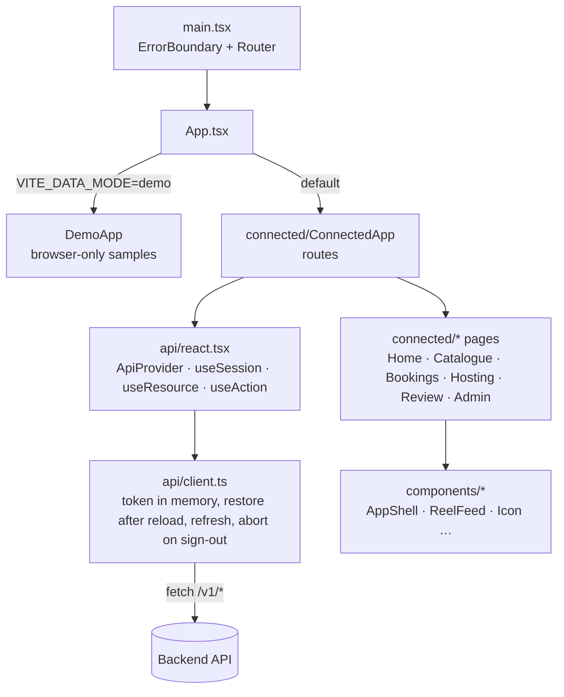

# Sikkim Experiences

React 19 · TypeScript · Vite · React Router. A mobile-first web app for discovering and booking local experiences in Sikkim, plus host and admin workspaces. It talks to the [backend API](../backend) under `/v1`.

- [System architecture and workflow diagrams](../docs/ARCHITECTURE.md)
- [Design rules and media credits](docs/DEMO.md) · [Approved prototype](docs/design-references/)
- [Remaining work](docs/planning/BACKLOG.md)

## Screens

| Area                         | Routes                                                                                                                                                                                                                             | Data                         |
| ---------------------------- | ---------------------------------------------------------------------------------------------------------------------------------------------------------------------------------------------------------------------------------- | ---------------------------- |
| Discovery                    | `/`, `/explore` (reels), `/explore?view=list`, `/experiences/:slug`, `/hosts`                                                                                                                                                      | API                          |
| Booking                      | `/experiences/:slug/book`, `/essentials/bookings`, tickets                                                                                                                                                                         | API (free bookings)          |
| Account                      | `/welcome` (one-time code by phone or email), `/onboarding` (name + interests), `/account` (profile: About you, Interests, Travel preferences, Notifications & privacy, Password & sign-in via `?section=`), `/settings`, `/saved` | API                          |
| Community                    | `/community`, events, stories                                                                                                                                                                                                      | API (joining and group chat) |
| Travel Essentials            | `/essentials`, `/essentials/:section`                                                                                                                                                                                              | Built-in guidance            |
| Host workspace               | `/hosting`, listings, dates, media, stories                                                                                                                                                                                        | API                          |
| Review                       | `/review`, `/review/hosts/:id`, `/review/experiences/:id`, `/review/media`                                                                                                                                                         | API, admins only             |
| **Operations (admin + CRM)** | `/admin?tab=overview\|pipeline\|tasks\|insights\|approvals\|hosts\|users\|bookings`, `/admin/leads/new`, `/admin/leads/:id`, `/admin/users/:id`                                                                                    | API, admins only             |
| Reels                        | `/explore` (experience + traveller reels), `/reels/new` (share a reel: **Camera** or **Photos**, also offered from the ＋ icon under Share in each reel's action rail)                                                             | API, reviewed by admins      |

The Operations workspace follows prototype screen S20: segmented tabs, metric tiles and red progress bars on the black theme.

## App structure



## Run locally

Use Node 22.12+ (Node 24 recommended) and start the backend on port 3000 first, with its latest migrations applied.

```sh
npm ci
npm run dev        # http://127.0.0.1:5173 — /v1 is proxied to the backend
```

Sample mode without a backend: `VITE_DATA_MODE=demo npm run dev`.

Sign in with a one-time code, or with **Sign in with password** (email or mobile number) once a password is added in Profile → Password & sign-in. Locally the backend prints codes in its log (`"event":"otp_dev_code"`).

Account types: **user** (everyone), **admin** (trips, reviews, pipeline, bookings) and **super** (also Overview analytics and the People directory). Grant staff access on the backend after the person has signed in once: `npm run admin -- grant --email=you@example.com --role=super`. Sign in again: Operations is in the header **Admin** button and the account menu.

## Configuration

Build-time variables (see `.env.example`). They end up in public JavaScript, so never put secrets here.

| Variable               | Default                   | Purpose                                                                                                                  |
| ---------------------- | ------------------------- | ------------------------------------------------------------------------------------------------------------------------ |
| `VITE_DATA_MODE`       | `api`                     | `api` uses the backend; `demo` uses browser-only samples                                                                 |
| `VITE_API_BASE_URL`    | `/v1`                     | API base path or absolute URL                                                                                            |
| `DEV_API_PROXY_TARGET` | `http://127.0.0.1:3000`   | Dev server only: where `/v1` is proxied                                                                                  |
| `VITE_PREVIEW_IMAGES`  | `true` dev, `false` build | Show concept images on `preview-` sample experiences. Test deployments only; never production (image rights unconfirmed) |

In production, serve `dist/` with an `index.html` fallback and route `/v1` to the API.

## Check

```sh
npm run build
npm test
npx playwright install chromium webkit
npm run test:api      # needs the backend running
npm run test:e2e
npm run format:check
```

## Known limits

Paid checkout and real email/SMS delivery of sign-in codes are not built yet. Group chat checks for new messages every few seconds; there are no push notifications or calls.

## Changelog

- **2026-11-21** `VITE_PREVIEW_IMAGES` lets a test deployment show the concept images on `preview-` sample experiences (previously dev server only). Off by default in builds.
- **2026-11-23** **Community groups.** The Community tab starts with **Your upcoming plans**: upcoming bookings (with **View ticket**) and the events you host or joined (Hosting / Confirmed / Waiting for host / Waiting list, with **Group chat** once you're confirmed). Event pages join, request, leave and withdraw for real, and hosts get **Manage your group** to confirm, decline or remove people. `/community/events/:id/chat` is the real group chat for the host and confirmed members, updated every 4 seconds while open.
- **2026-11-23** **Already booked?** The trip page shows your upcoming bookings for that trip with a link to the booking and ticket; the main button becomes **Book another date**. In the booking and reschedule date pickers, dates you've already booked are greyed out ("You're already booked on this date").
- **2026-11-23** Signing in lands on the **home page** (staff too), unless sign-in was asked for by a page such as a booking, which it returns to. People **stay signed in until they sign out**: reloads, new tabs and browser restarts restore the session from the API's HttpOnly cookie (`POST /v1/auth/resume`); the token itself still lives only in memory. Open tabs share one session and take turns renewing it (Web Locks).

- **2026-11-21** CRM intelligence in Operations: lead score badge on every pipeline row; lead page adds a **Lead score** panel (points per factor), the six assessment ratings and expected monthly value in the form, a **Tasks** panel, and an **AI brief** panel when the API has AI switched on (copy or open the follow-up in WhatsApp, apply suggested ratings). New **Tasks** tab (mine/everyone, open/finished/dropped, calendar download) and super-only **CRM insights** tab (revenue forecast, pipeline value by stage, health, hottest leads, time in stage, team table, CSV export). Same panels, badges and bars as the S20 Operations screens.

- **2026-11-21** Share a reel from **Camera** or **Photos**, from the ＋ icon under Share on each Explore reel. Phones open their own camera app (`capture`); laptops record in the page (up to 60 s, `MediaRecorder`). iPhone `.mov` videos are accepted.

- **2026-11-21** Password sign-in by email or mobile number; new profile section **Password & sign-in** to add or change a password (the one-time code keeps working).

- **2026-11-20** Account menu on the header avatar (every screen size once signed in): profile, bookings, saved, share a reel, host workspace, Operations for staff, privacy, **Sign out**. `/account` is now one profile page with a summary (contact, role, member since, bookings/saved/reels counts) and four sections: About you, Interests, Travel preferences, Notifications & privacy.

- **2026-11-20** Staff land in Operations after signing in; red **Admin** button in the header; account page starts with an Operations and CRM panel for staff.

- **2026-11-20** One-time-code sign-in with onboarding (S01/S02), role-aware Operations (admin vs super), account analytics and People directory, “Create a trip” entry point, traveller reels (share, review, shown in Explore).

- **2026-11-20** Operations workspace (`/admin`): overview metrics, curator CRM pipeline with lead editor and activity notes, approvals, hosts, users (suspend or restore), booking lookup. Host review can approve real hosts with a recorded identity-check method.
